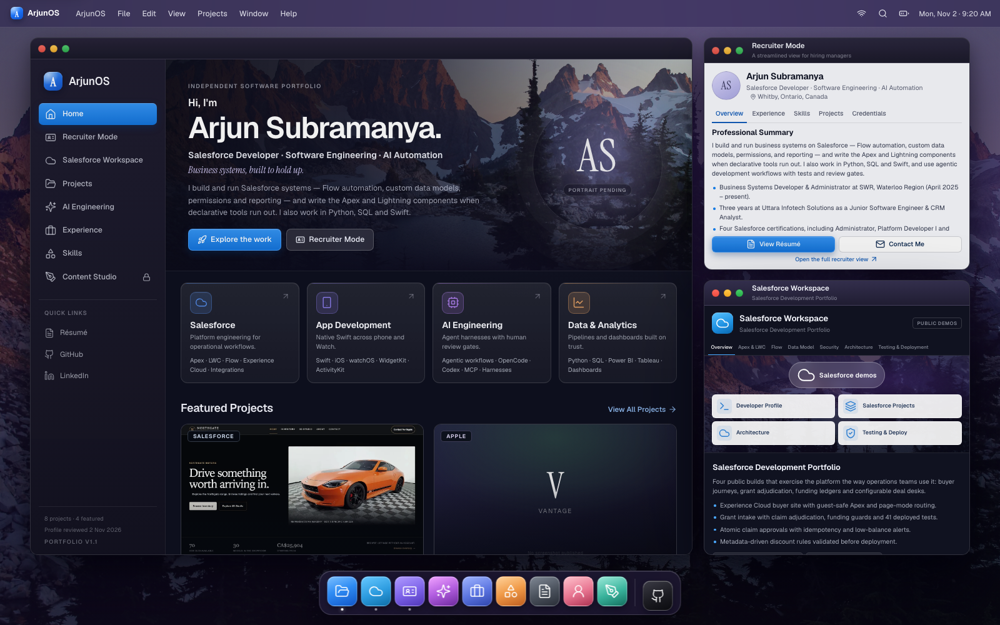
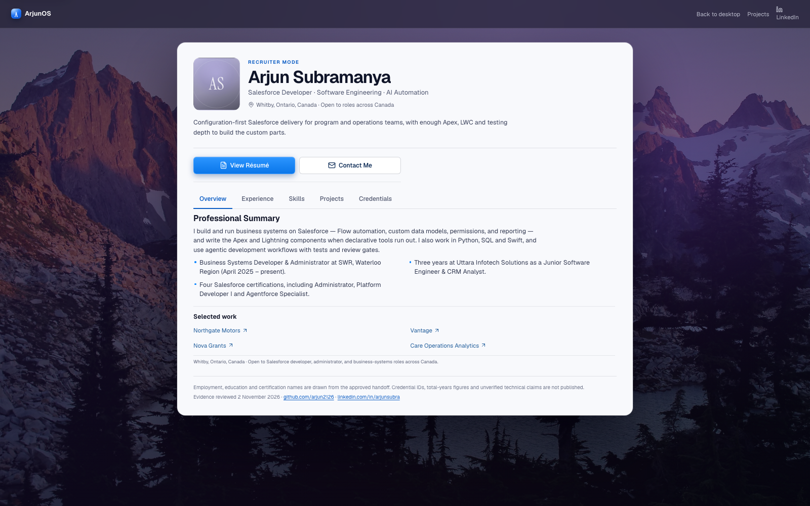
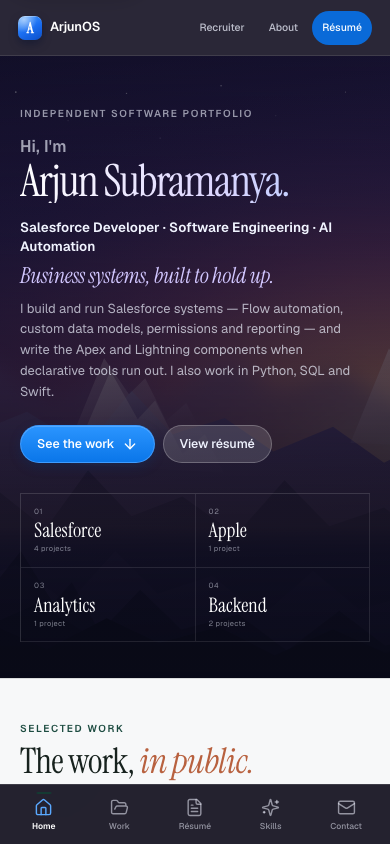
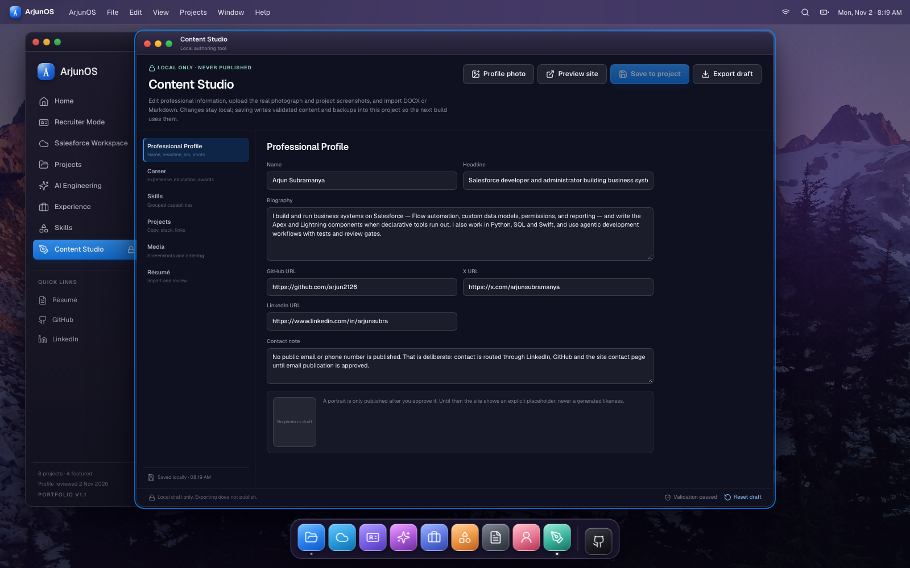

# ArjunOS

Public site: <https://arjun2126.github.io/>. Deployment status and evidence are recorded in
[docs/PROGRESS.md](docs/PROGRESS.md).
[Initial launch verification report](docs/LAUNCH_REPORT.md).

**Owner updates:** [Content Studio upload → review → save → validate → PR → deploy](docs/CONTENT_UPDATES.md).
Run `npm run dev` for local editing and `npm run publish:prepare` to validate a reviewed update.
No script automatically commits or pushes content. [Pages workflow](docs/GITHUB_PAGES.md).

An interactive, macOS-inspired portfolio for Arjun Subramanya. The desktop presents three layered applications — a main ArjunOS window, Recruiter Mode, and a Salesforce Workspace — alongside eight public repositories, a recruiter-friendly standalone view, an AI engineering showcase, a verified Northgate live-site fallback, and a local-only Content Studio.

Built with React 19, TypeScript, Vite, and CSS. No production backend, authentication, database, paid service, or external font CDN.



[Before/after visual comparison](docs/screenshots/polish-before-after-1600.png)

## Run it locally

Requires Node.js 22 or newer and npm.

```bash
npm install
npm run dev
```

Open the URL Vite prints, normally <http://localhost:5173>. The Content Studio save endpoint exists only on this dev server.

To reproduce the production build and preview it:

```bash
npm run build
npm run preview
```

`npm run preview` serves the generated `dist/` on <http://localhost:4173>. Direct routes such as `/projects/northgate-motors/` work because the build writes an HTML document for each public route.

## Routes

| Route | Experience |
| --- | --- |
| `/` | Desktop: main window, Recruiter Mode, Salesforce Workspace, Dock, menu bar |
| `/projects/` | Full project index with search and discipline filters |
| `/projects/:slug/` | Eight directly linkable case studies |
| `/recruiter/` | Standalone, recruiter-friendly profile with no desktop dependency |
| `/salesforce/` | Seven-part Salesforce development workspace |
| `/ai/` | AI engineering practice, labelled applied / experimental, with explicit non-claims |
| `/experience/` | Two professional roles, independent work, education and certifications |
| `/certifications/` | Credential gallery with issuers, published date status, verification links and an image/PDF viewer |
| `/resume/` | Professional profile with a downloadable PDF built from the approved content |
| `/skills/` | Skills grouped by discipline, each traceable to a project |
| `/about/` | Approach, scope, and how ArjunOS was built |
| `/contact/` | Location, LinkedIn and GitHub; no email or phone |
| `/northgate-live/` | Verified Northgate buyer-site window; genuine captures and direct links because Salesforce blocks framing |
| `/content-studio/` | Local-only authoring tool; hidden and inert outside loopback |

## Quality gates

```bash
npm run check       # TypeScript project build
npm test            # unit and local API security tests
npm run build       # production build + 20 prerendered HTML routes
npm run test:e2e    # builds, then runs Chromium journeys
```

The browser suite covers the three-window composition, window lifecycle, drag, viewport refitting, search and filters, direct URLs, keyboard shortcuts, skip navigation, Recruiter tabs and credentials, the standalone mobile recruiter layout, Content Studio DOCX import, photo persistence, Northgate live-site framing disclosure and route links, external-link allowlisting, mobile overflow, no-JavaScript pages, reduced motion, and axe scans at desktop and mobile sizes.

## Recruiter-readiness polish

The 2 November 2026 pass replaced the homepage greeting with **“Hi, I’m Arjun Subramanya.”**, added the verified Salesforce / software engineering / AI automation subtitle, strengthened the four linked skill cards, and moved featured work into a larger two-column grid. Desktop margins and window separation were increased, and the standalone Recruiter Mode now surfaces **View Résumé**, **Contact Me**, and selected work above its tabs. The mobile recruiter layout wraps all five tabs and keeps its actions visible.

The genuine portrait is still an owner input: no portrait file exists in this workspace, so the explicit placeholder remains instead of a generated or substituted face. The typographic Vantage cover remains until genuine screenshots are supplied.

## Professional content

The approved 2 November handoff populated two employment entries, two education credentials, four Salesforce certification names, city-level location, availability, LinkedIn, and the AI non-claims. The following are deliberately excluded: phone, street address, work-authorization status, compensation, application records, interview material, credential IDs, total-years figures, and the unconfirmed Matchpoint title/dates.

Employment and education dates that were unknown are shown as “not published” rather than invented. Detailed source coverage is recorded in [docs/SOURCES.md](docs/SOURCES.md).

## Content Studio

`/content-studio/` is a local authoring tool. It supports:

- Profile, headline, summary, links and an owner-supplied photograph.
- Professional experience, education and certification lists.
- Skill groups and project taglines, summaries and stacks.
- DOCX, Markdown, plain-text and JSON import with review-before-apply.
- Image uploads with automatic client-side resizing, project assignment, captions and ordering.
- Validation before saving.

Saving calls a Vite dev-only endpoint. It writes validated content to `src/content/studio.generated.json`, optimized WebP assets to `public/content-studio/`, the current draft to `content-studio/current.json`, and up to 20 timestamped backups to `content-studio/history/`. The server binds to loopback by default; saves require a loopback socket peer, a loopback Host on the listening port, and an exact matching HTTP Origin. State reads have the same peer/Host gate and reject cross-origin requests. Forwarded headers are not trusted. Then run `npm run build` to rebuild without editing source files. No save endpoint exists in production; the client route is hidden and inert outside loopback. Drafts/history and uploaded assets are Git-ignored; generated content and any intentionally staged uploads need a fresh privacy review.

PDF text extraction is not implemented. DOCX text is extracted locally in the browser; the file is never uploaded. `npm run build` renders the approved résumé to `dist/resume/arjun-subramanya-resume.pdf` with a headless Chromium pass over `src/lib/resumeDocument.ts`, so the deployed site serves a static two-page A4 PDF with no browser-side generation and no development server. `npm run resume:pdf` regenerates it on its own; the print action remains available for printing the web page.

## Authentic visual assets

The desktop wallpaper is **“Sunset at Tank Lakes, Alpine Lakes Wilderness”** by the U.S. Forest Service (Pacific Northwest Region), public domain, via Wikimedia Commons. It is resized and converted to WebP locally; provenance and licence are recorded in [docs/ASSETS.md](docs/ASSETS.md). No Apple wallpaper or proprietary system artwork is included. The macOS-like controls, Dock tiles and app marks are original CSS/SVG components, not screenshots.

## Architecture

- `src/content/projects.json` — source-of-truth project registry.
- `src/content/professional.ts` — approved employment, education, certifications, AI boundaries.
- `src/content/profile.ts` — public profile, skills and contact routes.
- `src/content/generated.ts` — build-time overlay from a locally saved studio draft.
- `src/content/expertise.ts` — competencies, recruiter profile, Salesforce sections, AI practice.
- `src/content/northgateLive.ts` — verified public buyer URLs, framing evidence and genuine capture metadata.
- `src/components/os/NorthgateLive.tsx` — non-proxying live-site window with fallback and external actions.
- `server/content-studio-plugin.ts` — local-only save API, image optimization and backups.
- `src/lib/windows.ts` — pure window-state model and three-window composition.
- `src/components/os/` — desktop applications and Content Studio.
- `src/styles/` — tokens, desktop, window chrome, document apps, mobile and `os.css`.
- `scripts/prerender.ts` — route-specific HTML, metadata, structured data and no-JavaScript content.

## Static hosting and SEO

`npm run build` emits route-specific titles, descriptions, Open Graph tags, JSON-LD and readable fallback content for 20 routes. The approved production origin defaults to `https://arjun2126.github.io`, generating absolute canonical URLs and a sitemap. For an explicitly approved alternative host, override the public origin:

```bash
SITE_URL=https://your-domain.example npm run build
```

Host `dist/` on any static host that serves `route/index.html` for directory URLs. `404.html` is generated for not-found handling. No deployment is performed by these commands.

The build verifies public directory routes, local links/assets, canonical URLs,
sitemap, `.nojekyll` and `404.html`. GitHub Pages is **not activated** and no
deployment workflow is included. See [docs/GITHUB_PAGES.md](docs/GITHUB_PAGES.md)
for the gated hosting plan and [docs/REPOSITORY_PREPARATION.md](docs/REPOSITORY_PREPARATION.md)
for preparation validation and privacy evidence.

## Content and limitations

Project facts come from public repository documentation reviewed on 2 November 2026. Professional details come from the owner-approved handoff. Project test counts shown in case studies are quoted from those repositories and were not re-run here; the ArjunOS gate counts above were executed against this workspace. Demo data is labelled as fictional or synthetic. Five repositories publish no product screenshots, so they use typographic covers rather than reconstructed captures.

The attached chat photograph was **not available to this workspace as a file**, so the site still shows the explicit portrait placeholder. Content Studio is ready to accept the original image and write it into the build; no generated likeness is used. Genuine Vantage screenshots remain owner inputs.

No email address or phone number is published. Email publication is still approval-gated. The downloadable résumé PDF is generated at build time from the same approved content as the web page and contains no phone number, email address or credential ID. The live Northgate buyer site sends `X-Frame-Options: SAMEORIGIN` and `frame-ancestors 'self'`, so Northgate Live deliberately uses captures and external links rather than a proxy or a weakened Salesforce setting. True embedding is owner-approval-gated and documented in [docs/NORTHGATE_LIVE.md](docs/NORTHGATE_LIVE.md). The full quality record is in [docs/QUALITY_REPORT.md](docs/QUALITY_REPORT.md).

## More views

| Recruiter Mode | Mobile | Content Studio |
| --- | --- | --- |
|  |  |  |
